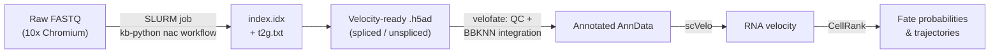

# velofate

**A Python meta-package for reconstructing single-cell RNA velocity and cell-fate trajectories — from raw FASTQ to fate probabilities.**

`velofate` bundles the full workflow developed for the MSc thesis *"Reconstructing Tumor Progression Trajectories in Clear Cell Renal Cell Carcinoma Using Single-Cell RNA Sequencing"* (University of Bern, 2026) into one installable, version-pinned environment, so the pipeline can be reused beyond a single project.


## Table of contents

- [Overview](#overview)
- [Workflow](#workflow)
- [Repository structure](#repository-structure)
- [Installation](#installation)
- [The meta-package: `pyproject.toml`](#the-meta-package-pyprojecttoml)
- [1. Raw FASTQ → velocity-ready matrices (SLURM)](#1-raw-fastq--velocity-ready-matrices-slurm)
- [2. Downstream analysis (notebooks)](#2-downstream-analysis-notebooks)
- [Data](#data)
- [Citation](#citation)
- [Acknowledgments](#acknowledgments)
- [License](#license)

## Overview

Single-cell velocity/fate analysis usually lives as a loose chain of cluster scripts, ad hoc conda environments, and one giant notebook — hard for anyone but the original author to rerun. `velofate` packages that chain into two explicit stages:

1. **Quantification** — raw FASTQ → spliced/unspliced count matrices, run on an HPC cluster via SLURM.
2. **Analysis** — QC, batch integration, RNA velocity, and CellRank fate mapping, run through the `velofate` package itself.

It was built and validated on a 15-sample clear cell renal cell carcinoma (ccRCC) scRNA-seq atlas, but the package and pipeline are dataset-agnostic.

## Workflow



## Repository structure

```
velofate/
├── pyproject.toml                 # meta-package definition & pinned dependencies
├── src/velofate/                  # importable package
├── slurm/
│   └── fastq_to_velocity.sbatch   # raw FASTQ → velocity-ready .h5ad (kb-python nac workflow)
├── reference/
│   └── t2g.txt                    # transcript-to-gene map (kb ref output, GRCh38)
├── notebooks/
│   ├── full_workflow.ipynb        # complete atlas analysis: QC → integration → velocity → fate
│   └── quickstart_example.ipynb   # minimal end-to-end example on a small demo dataset
├── data/                          # not tracked in git — see Data section
└── README.md
```

## Installation

```bash
git clone https://github.com/ChouvardasLab/velofate.git
cd velofate
pip install -e .
```

Because `velofate` is a meta-package, this single command pulls in the exact tool stack the pipeline was built and validated against — no separate environment-hunting required.

## The meta-package: `pyproject.toml`

This is the core of the repo: rather than a `requirements.txt` with loose version ranges, `pyproject.toml` pins the specific releases of every tool the pipeline depends on, so results stay reproducible as the single-cell ecosystem moves fast underneath it.

```toml
[project]
name = "velofate"
version = "0.1.0"
description = "Meta-package bundling the scRNA-seq -> RNA velocity -> cell-fate workflow (kb-python, scanpy, BBKNN, scVelo, CellRank) into one reproducible environment."
readme = "README.md"
requires-python = ">=3.10,<3.11"
license = { text = "MIT" }
authors = [{ name = "Your Name", email = "you@example.com" }]

dependencies = [
    "kb-python==0.29.5",
    "scanpy==1.10.4",
    "bbknn==1.6.0",
    "scvelo==0.3.4",
    "cellrank",        # pin to the version validated against this pipeline
    "anndata",
    "leidenalg",
    "python-igraph",
]

[project.optional-dependencies]
dev = ["jupyter", "ipykernel", "pytest"]
# regvelo = ["regvelo"]  # uncomment if the GRN-informed velocity extension ships too

[build-system]
requires = ["hatchling"]
build-backend = "hatchling.build"
```

> Replace the placeholders above (author, build backend, exact `cellrank` pin) with your actual file — this mirrors the environment the thesis results were produced with.

## 1. Raw FASTQ → velocity-ready matrices (SLURM)

`slurm/fastq_to_velocity.sbatch` runs the quantification stage on an HPC cluster using `kb-python` v0.29.5's `nac` workflow, which produces spliced and unspliced counts in a single pass:

```bash
# Build the reference (once)
kb ref -d human --workflow nac

# Quantify one sample
kb count -i index.idx -g t2g.txt \
    -c1 spliced_t2c.txt -c2 unspliced_t2c.txt \
    --workflow nac -x 10XV2 --filter bustools --h5ad -t 16 \
    R1.fastq.gz R2.fastq.gz
```

This produces, per sample, a `--filter bustools`-filtered `.h5ad` with `spliced`/`unspliced` layers — ready for `scv.pp.moments()` without further reformatting. Reference build: GRCh38.

## 2. Downstream analysis (notebooks)

| Notebook | Purpose |
|---|---|
| `notebooks/full_workflow.ipynb` | The complete analysis as run for the thesis: QC/filtering → BBKNN integration → Leiden clustering → cell-type annotation → scVelo (stochastic/dynamical) → CellRank fate probabilities, GPCCA macrostates, and lineage drivers. |
| `notebooks/quickstart_example.ipynb` | A minimal, heavily-commented walkthrough on a small demo dataset — the fastest way for a new user to see the whole pipeline run end to end. |

## Data

Analyses were run on a subset of **Alchahin et al. (2022)**, GEO accession [**GSE178481**](https://www.ncbi.nlm.nih.gov/geo/query/acc.cgi?acc=GSE178481) (10x Chromium 3′ v2, Illumina NextSeq 500, paired-end).

**Recommendation:** don't commit raw FASTQs or full `.h5ad` matrices to this repo — they're large, and GEO is already the canonical, versioned source. A cleaner pattern:
- `data/` stays git-ignored, with a short `data/README.md` pointing to the GEO accession and the exact `kb-python` commands to regenerate it.
- Ship only a small, subsampled `.h5ad` alongside `quickstart_example.ipynb` so the notebook runs out of the box.

## Citation

If you use `velofate`, please cite:

> [Your Name]. *Reconstructing Tumor Progression Trajectories in Clear Cell Renal Cell Carcinoma Using Single-Cell RNA Sequencing.* MSc thesis, University of Bern, 2026.

Consider also adding a [`CITATION.cff`](https://citation-file-format.github.io/) file so GitHub surfaces a "Cite this repository" button automatically.

## Acknowledgments

Developed in the ChouvardasLab, University of Bern, under the supervision of Dr. Sofia Karkampouna and Dr. Panagiotis Chouvardas.

## License

Not yet specified — for academic tooling like this, [MIT](https://choosealicense.com/licenses/mit/) or [BSD-3-Clause](https://choosealicense.com/licenses/bsd-3-clause/) are common, permissive choices. Add a `LICENSE` file at the repo root once decided.
