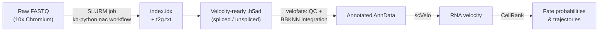

# velofate

**A Python meta-package for reconstructing single-cell RNA velocity and cell-fate trajectories. From raw FASTQ to fate probabilities.**

`velofate` bundles the full workflow developed for the MSc thesis *"Reconstructing Tumor Progression Trajectories in Clear Cell Renal Cell Carcinoma Using Single-Cell RNA Sequencing"* (University of Bern, 2026) into one installable, version-pinned environment, so the pipeline can be reused beyond a single project.


## Table of contents

- [Overview](#overview)
- [Workflow](#workflow)
- [Repository structure](#repository-structure)
- [Installation](#installation)
- [The meta-package: `pyproject.toml`](#the-meta-package-pyprojecttoml)
- [1. Raw FASTQ → velocity-ready matrices (SLURM)](#1-raw-fastq--velocity-ready-matrices-slurm)
- [2. Downstream analysis (notebooks)](#2-downstream-analysis-notebooks)
- [Data](#data)
- [Citation](#citation)
- [Acknowledgments](#acknowledgments)
- [License](#license)

## Overview

Single-cell velocity and fate analysis is often spread across multiple scripts, custom environments and large notebooks, making it difficult for others to reproduce. `velofate` organizes this workflow into two clear stages:

1. **Quantification**: raw FASTQ → spliced/unspliced count matrices, run on an HPC cluster via SLURM.
2. **Analysis**: QC, batch integration, RNA velocity, and CellRank fate mapping, run through the `velofate` package itself.

It was built and validated on a 15-sample clear cell renal cell carcinoma (ccRCC) scRNA-seq atlas, but the package and pipeline are dataset-agnostic.

## Workflow



## Repository structure

```
velofate/
├── src/velofate/                  # importable package
├── notebooks/
│   ├── full_workflow.ipynb        # complete atlas analysis: QC → integration → velocity → fate
│   └── quickstart_example.ipynb   # minimal end-to-end example on a small demo dataset
├── reference/
│   └── t2g.txt                    # transcript-to-gene map (kb ref output, GRCh38)
├── slurm/
│   └── 01_build_reference.sh      # build reference
│   └── 02_generate_h5ad.sh        # raw FASTQ → velocity-ready .h5ad (kb-python nac workflow)
├── README.md
├── environment.yml                # conda environment (Python + PETSc/SLEPc, then pip)
├── pyproject.toml                 # meta-package definition & pinned dependencies
└── requirements.txt               # fully pinned lock of the validated environment
```

## Installation

```bash
git clone https://github.com/ChouvardasLab/velofate.git
cd velofate
pip install -e ".[notebooks]"
```

Optional extras:
 
| Extra | Installs | Use for |
|---|---|---|
| `notebooks` | ipykernel, ipywidgets | running the workflow notebooks |
| `quant` | kb-python 0.29.5 | the FASTQ → `.h5ad` SLURM step (best kept in its own environment) |
| `petsc` | mpi4py, petsc4py, slepc4py | faster CellRank/pyGPCCA solvers on large datasets |
| `dev` | pytest | testing |
 
The PETSc/SLEPc solvers compile from source under pip, so install them with conda instead:
 
```bash
conda install -c conda-forge petsc4py slepc4py mpi4py
```
 
Check that your environment matches the validated stack:
 
```python
import velofate
velofate.versions()
```

Because `velofate` is a meta-package, this single command pulls in the exact tool stack the pipeline was built and validated against, no separate environment-hunting required.

## The meta-package: `pyproject.toml`

`pyproject.toml` pins the specific releases of every tool the pipeline depends on, so results stay reproducible as the single-cell ecosystem moves fast underneath it.

This is the core of the repo. `velofate` contains no analysis code of its own — its job is to pin the exact releases of every tool the workflow uses (scanpy 1.10.4, BBKNN 1.6.0, scVelo 0.3.4, CellRank 2.0.7 and their numerical backbone), taken directly from the environment the thesis results were produced in. Installing it reproduces that environment in one step, so results stay reproducible as the single-cell ecosystem moves on underneath it.

## 1. Raw FASTQ → velocity-ready matrices (SLURM)

`slurm/01_build_reference.sh` and `slurm/02_generate_h5ad.sh` runs the quantification stage on an HPC cluster using `kb-python` v0.29.5's `nac` workflow, which produces spliced (mature) and unspliced (nascent) counts in a single pass:

```bash
# Build the reference (once)
kb ref -d human --workflow nac \
    -i index.idx -g t2g.txt \
    -c1 spliced_t2c.txt -c2 unspliced_t2c.txt \
    -f1 spliced.fa -f2 unspliced.fa

# Quantify one sample
kb count -i index.idx -g t2g.txt \
    -c1 spliced_t2c.txt -c2 unspliced_t2c.txt \
    --workflow nac -x 10XV2 --filter bustools --h5ad
    -o sample_output --t 16 \
    R1.fastq.gz R2.fastq.gz
```

This produces, per sample, a `--filter bustools`-filtered `.h5ad` with `mature`, `nascent` and `ambiguous` layers. These are mapped to `spliced = mature + ambiguous` and `unspliced = nascent`. Reference build: GRCh38.

## 2. Downstream analysis (notebooks)

| Notebook | Purpose |
|---|---|
| `notebooks/full_workflow.ipynb` | The complete analysis as run for the thesis: QC/filtering → BBKNN integration → Leiden clustering → cell-type annotation → scVelo (stochastic/dynamical) → CellRank fate probabilities, GPCCA macrostates, and lineage drivers. |
| `notebooks/quickstart_example.ipynb` | A minimal, demonstration of a simple workflow. The whole pipeline run end to end. |

## Data

Analyses were run on a subset of **Alchahin et al. (2022)**, GEO accession [**GSE178481**](https://www.ncbi.nlm.nih.gov/geo/query/acc.cgi?acc=GSE178481) (10x Chromium 3′ v2, Illumina NextSeq 500, paired-end).

## Citation

## Acknowledgments

Developed in the Chouvardas Lab (DBMR), University of Bern, under the supervision of Dr. Sofia Karkampouna and Dr. Panagiotis Chouvardas.

## License

This project is licensed under the [MIT License](LICENSE).
